# 🦠 Endpoint Threat Detection — Trojan Attack Simulation (Wazuh + Sysmon)

A full-chain endpoint intrusion detected and investigated end-to-end in a home SOC lab. A trojan disguised as a pirated game is delivered to a Windows 11 endpoint; **Wazuh SIEM with Sysmon telemetry** detects every stage, and the incident is investigated back to its root cause the way a SOC analyst would.


> ⚠️ **Lab disclaimer.** Every action here was performed in an isolated, host-only lab that I own, for defensive training. The offensive steps are described at a high level only; this repository focuses on **detection, investigation and response**. Full details are in the PDFs under [`docs/`](docs/).

---

## 📌 Objectives

- Simulate a realistic multi-stage attack (initial access → privilege escalation → persistence)
- Collect endpoint telemetry with **Sysmon** and **Windows Security logs**
- Forward and analyse it in **Wazuh SIEM**
- Detect each stage of the attack through SIEM alerts
- Investigate by pivoting from a single alert to the root cause
- Map the activity to **MITRE ATT&CK** and design an automated response

---

## 🏗️ Lab Architecture

```
┌────────────────────┐    deliver    ┌────────────────────┐    logs     ┌──────────────────┐
│  Kali (Attacker)   │ ───────────▶ │  Windows 11        │ ──────────▶ │  Wazuh SIEM      │
│  192.168.64.7      │              │  Endpoint (victim) │  (agent)    │  192.168.64.6    │
│                    │              │  192.168.64.4      │             │  manager/indexer │
└────────────────────┘              │  + Sysmon + agent  │             │  + dashboard     │
└────────────────────┘             └──────────────────┘
      Isolated UTM network — 192.168.64.0/24
```

| Component | Role |
|---|---|
| Wazuh 4.14.3 (all-in-one) | SIEM — manager, indexer, dashboard |
| Sysmon 15.21 (SwiftOnSecurity config) | Endpoint telemetry |
| Wazuh Agent 4.14.3 | Log forwarding from Windows |
| Windows 11 Pro (`DESKTOP-4VD18QN`) | Victim endpoint, user `soc-admin` |
| Windows Defender | Endpoint antivirus (its detections are also ingested) |

---

## 🔗 Attack Chain & Detection Coverage

| # | Stage | Wazuh Rule | Level | MITRE |
|---|---|---|---|---|
| 1 | Trojan dropped to disk | 92213 | **15** | T1105 |
| 2 | Payload executed | 100103 | 5 | T1204.002 |
| 3 | C2 connection (`:4444`) | 100104 | 3 | T1071 |
| 4 | UAC bypass (fodhelper) | 92055 / 92305 | 12 | T1548.002 |
| 5 | Defender detection | 62123 | 12 | — |
| 6 | Backdoor account created | 60109 | 8 | T1136.001 |
| 7 | Added to Administrators | 60154 | 12 | T1484 |
| 8 | Run-key persistence | 100108 / 92041 | 8 / 10 | T1547.001 |

Every stage of the attack generated at least one alert. The trojan drop fired **rule 92213 at level 15** (the highest severity), and even the *failed* first UAC-bypass attempt left a high-severity trail.

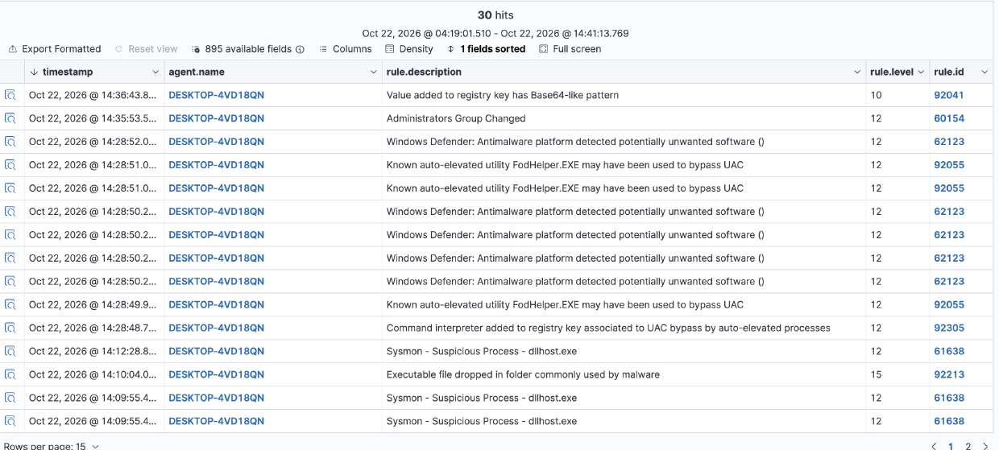
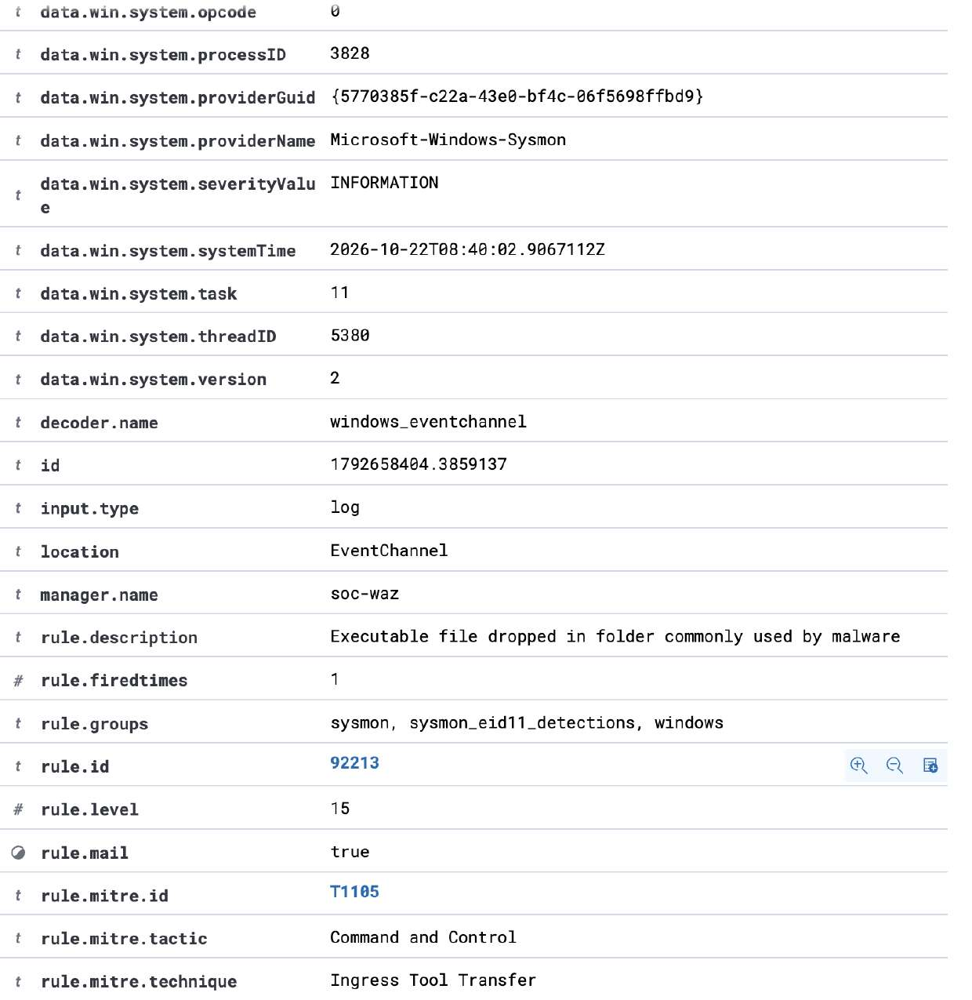

---

## 🔎 Investigation Walkthrough

The incident was worked the way a real analyst works it: start from one alert, with no prior knowledge, and pivot through the SIEM to the root cause.

**1. Start from the critical alert** — filter to `rule.level >= 12`. "Administrators Group Changed" (rule 60154) stands out.
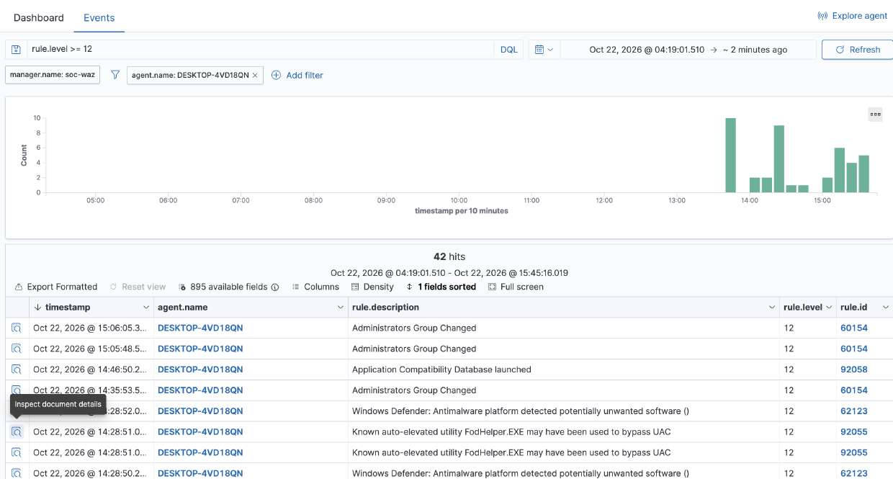

**2. What happened** — an account (SID `-1006`) was added to the Administrators group by `soc-admin`.
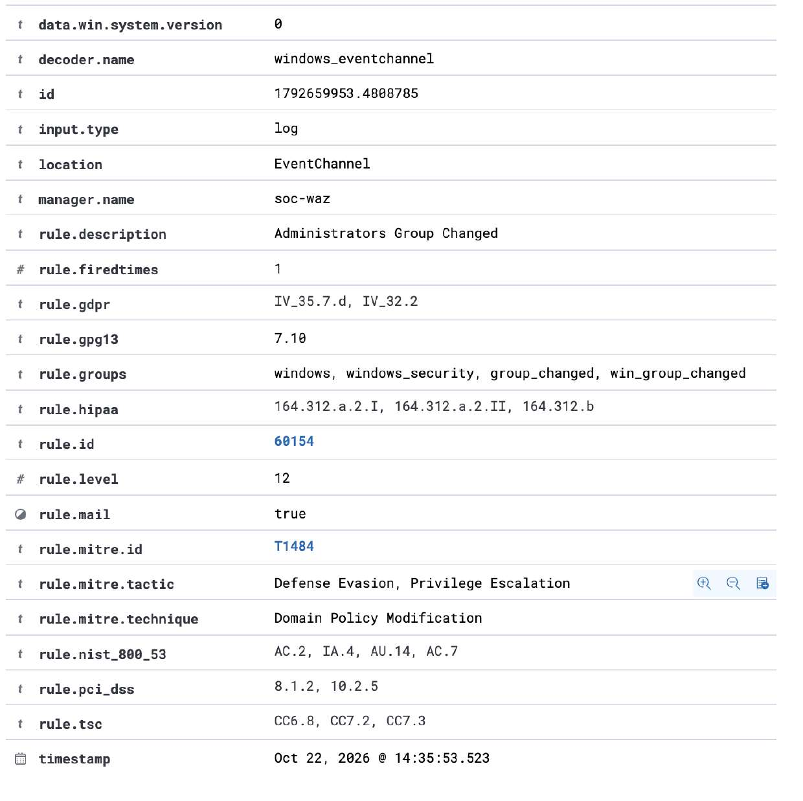

**3. Trace the account** — the same SID belongs to `svc_helpdesk`, created seconds earlier (event 4722). An unknown account created and instantly made admin is a classic backdoor pattern.
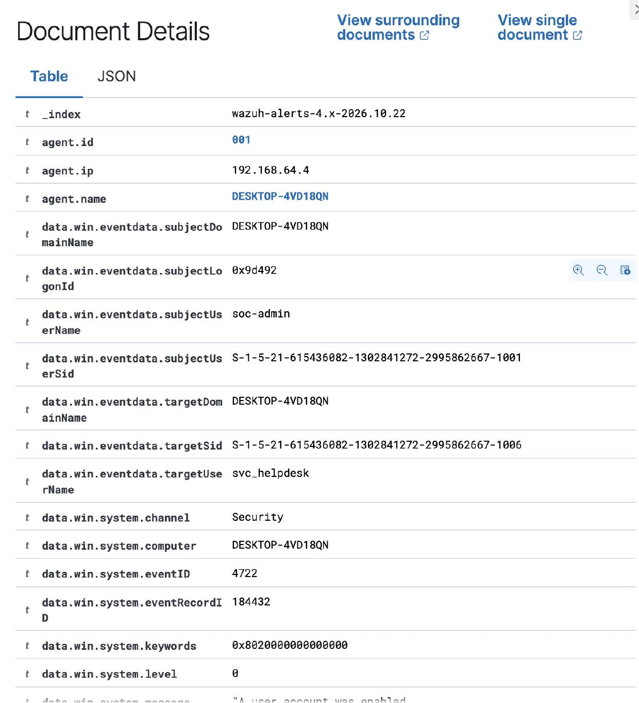

**4. How they got the rights** — a UAC bypass: `fodhelper.exe` launched by `cmd.exe`, running at High integrity (rule 92055, T1548.002).
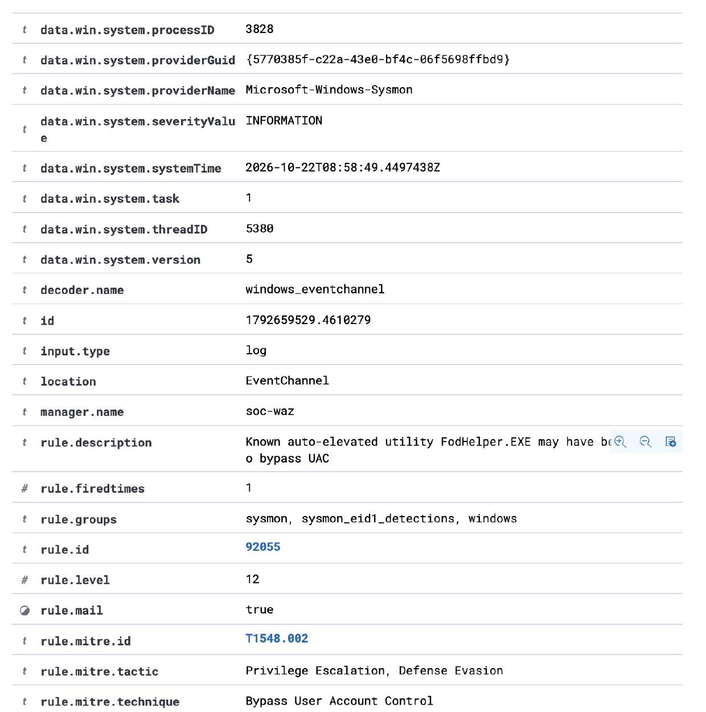

**5. The malicious process & C2** — pivoting on the payload filename shows its full lifecycle, including the outbound connection to `192.168.64.7:4444`.
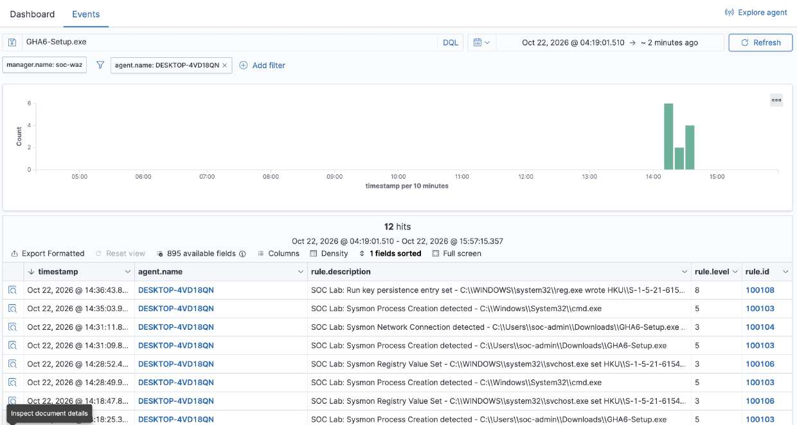
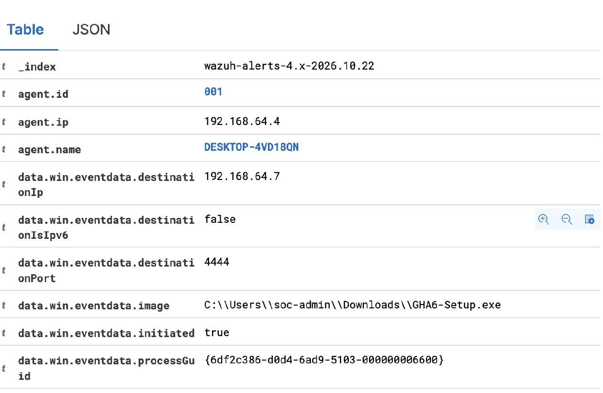

**6. Root cause** — the file-creation event shows `chrome.exe` created the payload, carrying a `Zone.Identifier` ("Mark of the Web"): the user downloaded it from the browser.
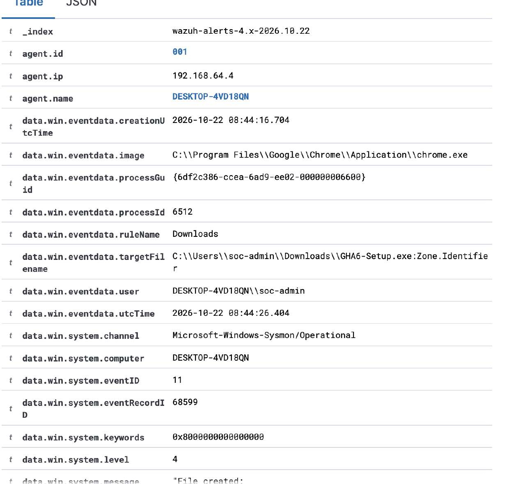

> One false lead (a normal `__PSScriptPolicyTest` PowerShell file) was correctly ruled out during the investigation.

---

## 🛡️ Response & Containment

A Wazuh **Active Response** was built to disable the backdoor account automatically when rule 60154 fires. The script was validated and correctly flips `svc_helpdesk` from active to disabled.

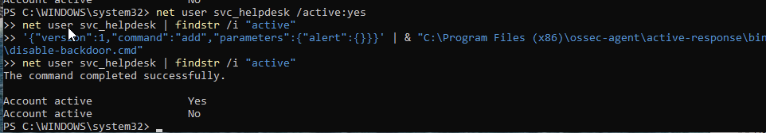

> **Honest note on status:** the containment script and SIEM-side config are in place and proven, but automatic dispatch to the ARM Windows agent did not complete reliably in testing, so containment for this incident was performed **manually**. This is documented as an open item. *(The active-response script was developed with AI assistance.)*

The host was then eradicated and verified — backdoor account deleted, Run key removed, payload deleted, Defender exclusions restored.
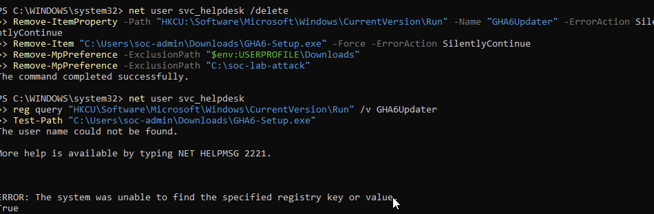

---

## 🎯 MITRE ATT&CK Mapping

| Tactic | Technique | ID |
|---|---|---|
| Initial Access | Phishing / Drive-by | T1566 / T1189 |
| Execution | User Execution: Malicious File | T1204.002 |
| Command & Control | Ingress Tool Transfer / App Layer Protocol | T1105 / T1071 |
| Privilege Escalation / Defense Evasion | Bypass User Account Control | T1548.002 |
| Persistence | Create Account: Local Account | T1136.001 |
| Privilege Escalation | Account / Policy Modification | T1484 / T1098 |
| Persistence | Registry Run Key | T1547.001 |

---

## 🧾 Indicators of Compromise (lab)

| Type | Indicator |
|---|---|
| Attacker IP | `192.168.64.7` |
| C2 port | `4444/TCP` |
| Backdoor account | `svc_helpdesk` |
| Persistence key | `HKCU\...\CurrentVersion\Run\GHA6Updater` |
| Technique marker | `fodhelper.exe` spawned by `cmd.exe` |

---

## 🛡️ Recommendations (production)

- Remove local admin rights from standard users
- Enforce application allow-listing for unsigned downloaded installers
- Keep Defender real-time protection enforced; prevent users disabling it
- Alert on privileged-group changes by **SID**, not account name
- Monitor for UAC-bypass techniques (e.g. `fodhelper.exe` abuse)
- Add network/DNS monitoring (e.g. Zeek) to catch C2 channels Sysmon misses

---

## 📚 Skills Demonstrated

`Wazuh SIEM` · `Sysmon` · `Custom detection rules` · `Kill-chain detection` · `Alert triage` · `SIEM pivoting` · `Root-cause analysis` · `MITRE ATT&CK` · `Active Response design` · `Incident reporting`

---

## 📄 Full Documents

- 📘 [Project Documentation (PDF)](docs/project-documentation.pdf)
- 📝 [Incident Report (PDF)](docs/incident-report.pdf)
